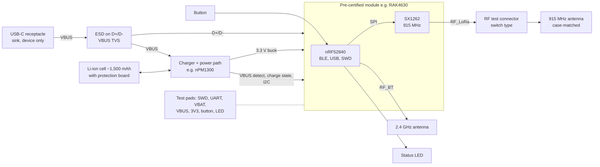

# Phone radio board: requirements on paper

Requirements for the phone radio board (tech tree node T-MSG1), so layout can start the day the bench results allow it. Task card: [#40](https://github.com/joinoasa/oasa-radio/issues/40). This page lives here until the `oasa-phone-radio` repo exists.

**Status:** draft, written 2026-11-15 from web pages only. No schematic, no layout, no parts ordered. Hardware is frozen only after the signal it carries passes the bench (three-track roadmap, step C1).

**Labels.** Every number carries one: **[DS]** datasheet, **[VP]** vendor or distributor page (fetched 2026-11-15), **[GR]** FCC grant or test document, **[EST]** our estimate. Prices change daily; a price is good only for the date beside it. Nothing here is a range claim or a regulatory judgement; where a grant says something, it is quoted with a link.

## What the board is

- nRF52840-class processor: Bluetooth LE to the phone, USB device.
- SX1262 LoRa radio, 915 MHz band.
- A pre-certified module (RAK4630 or similar), not discrete radio chips.
- Li-ion or LiPo cell, about 1,500 mAh **[EST]**. No power bank.
- One USB-C port: charging, and data only as a USB device.
- One button, one status light.
- Antenna matched to the case, with the battery between the antenna and the body.
- Firmware in Rust with Embassy.

## Block diagram

Body side, front to back: body, battery, board, antenna. The battery sits between the antenna and the body.

## Module candidates

Prices fetched 2026-11-15. "Stock" is the number the page showed that day.

| Option | What it is | Price and stock | Certification | Notes |
|---|---|---|---|---|
| **A. RAK4630** (RAK4630-9-SM-I, US915) | nRF52840 + SX1262 in one stamp module, 15 x 23 x 3 mm **[VP]** ([datasheet page](https://docs.rakwireless.com/product-categories/wisduo/rak4630-module/datasheet/)) | RAK store: $15.00, 900 MHz variants listed as available, no quantity shown **[VP]** ([store](https://store.rakwireless.com/products/rak4630-nrf52840-sx1262-lora-bluetooth-module-for-lorawan)). DigiKey 4735-RAK4630-9-SM-I-ND: $33.74 (1), $25.99 (100), $24.74 (1,000), stock 100. LCSC C33033533: $19.13 (1), $18.62 (10+), stock 85 **[VP]** ([Octopart listing](https://octopart.com/search?q=RAK4630-9-SM-I)) | FCC ID 2AF6B-RAK4630, grants dated 11/27/2020, "Single Modular" **[GR]** ([RAK compliance page](https://docs.rakwireless.com/certification/product-compliance-certification/wisblock/rak4630-rak4631/), [FCC grant zip](https://downloads.rakwireless.com/LoRa/RAK4630/Certification/RAK4630_RAK4631_FCC_Certification.zip)) | Same chips as the RAK4631 development board. BLE and LoRa are RF pins; the host board carries both antennas (or the MHF1 variant). See the grant note below |
| **B. Fanstel BT840F + LR62E** | Two modules: BT840F (nRF52840, built-in PCB antenna) and LR62E (SX1262, u.FL connector), LR62E 10.2 x 15 mm **[DS]** ([LR62E spec](https://fanstel.squarespace.com/s/LR62E_LR62XE_M262X840XE_Product-Specifications-4b79.pdf)) | BT840F, Mouser 308-BT840F: $13.39 (1), $10.21 (100), $9.17 (1,000), stock 6,154. LR62E, Mouser 308-LR62E: $13.65 (1), $10.40 (100), $8.99 (1,000), stock 373 **[VP]** ([BT840F](https://octopart.com/search?q=BT840F), [LR62E](https://octopart.com/search?q=LR62E)). Fanstel direct: BT840F $7.89 (100-pack), $7.17 (1,000); LR62E $8.00 (1-999), $7.32 (1,000) **[VP]** ([LR62E page](https://fanstel.squarespace.com/lr1262), [BT840 page](https://fanstel.squarespace.com/bt840)) | LR62E: FCC ID X8WLR62E, IC 4100A-LR62E **[VP]** ([Fanstel](https://fanstel.squarespace.com/lr1262)). BT840F: FCC ID X8WBT840F **[VP]** ([Fanstel](https://fanstel.squarespace.com/bt840)). Grant text not read | The spec sheet says the end product "may subject to perform FCC part 15 unintentional emission test" **[DS]**. LR62E max TX +20.3 dBm (US) **[DS]**, below the RAK4630's 22 dBm |
| C. Elecrow nRFLR1262 (CIL13462X) | nRF52840 + SX1262, 20 x 20 x 3.5 mm LGA-80, no antenna on module **[VP]** | $11.90, "In stock" **[VP]** ([Elecrow](https://www.elecrow.com/elecrow-nrflr1262-wireless-transceiver-module-integrates-nordic-nrf52840-and-semtech-sx1262.html)). Not on Octopart | Page says "FCC, CE RoHS certification", no FCC ID shown **[VP]** | Cheapest combo. Grant not found |
| D. Heltec HT-N5262M | nRF52840 + SX1262, stamp holes, two IPEX connectors, 30 x 20 x 3.2 mm **[VP]** | $14.90, no stock figure, no volume price **[VP]** ([Heltec](https://heltec.org/project/ht-n5262m/)) | None stated on the page | Larger than A. Not a pre-certified option unless a grant turns up |
| E. Raytac MDBT50Q-1MV2 + an SX1262 module | nRF52840 module plus LR62E or similar | MDBT50Q-1MV2: DigiKey Marketplace $6.15, stock 50; TME $8.10 (100), stock 0 **[VP]** ([Octopart](https://octopart.com/search?q=MDBT50Q-1MV2)) | Raytac page lists certifications for its family but no ID for this part **[VP]** ([Raytac](https://www.raytac.com/product/ins.php?index_id=89)) | Same shape as B |
| F. Ebyte E22-900M22S (SX1262 only) | SX1262 module, pair with an nRF52840 module | Chipsmall (not an authorized distributor): $6.97 (100), stock 300 **[VP]** ([Octopart](https://octopart.com/search?q=E22-900M22S)) | Vendor manual claims FCC; no FCC ID found for this part. Sibling E22-900T22S has 2ALPH-E22900T22S **[VP]** | Listed for completeness |

**What the RAK4630 grant says** (both grants, quoted) **[GR]**:

> Modular Approval. Output power listed is conducted. This transmitter is approved for use in mobile RF exposure category configurations with the antenna(s) installed to provide a separation distance of at least 20 cm from all persons. [...] Installation of this device into portable RF Exposure category host devices requires the submission of a Class II permissive change or new application.

Frequency and power on the grants: 902.3-914.9 MHz, 0.036 W (DSS); 903.0-914.2 MHz, 0.038 W and 2402-2480 MHz, 0.003 W (DTS) **[GR]**. A RAK forum user reports the FCC filing used a 3.0 dBi antenna ([forum](https://forum.rakwireless.com/t/rak4631-fcc-antenna-options/13586)); not checked against the test report, whose antenna pages are images. What this means for a device carried in a pocket is not judged here; we only record the text.

**Supply limits that shape the power design (RAK4630)** **[VP]** ([datasheet page](https://docs.rakwireless.com/product-categories/wisduo/rak4630-module/datasheet/)): VBAT_SX and VBAT_IO_SX 2.0-3.7 V; VDD_NRF 2.0-3.6 V; VBAT_NRF (nRF VDDH) 2.5-5.5 V; VBUS 4.35-5.5 V. A full Li-ion cell (4.2 V) is above the SX1262 limit, so the board needs a 3.3 V regulator. BLE TX power is listed as -20 to +4 dBm.

## Power parts

| Function | Candidate | Key figures | Price (fetched 2026-11-15) |
|---|---|---|---|
| Charger + bucks + fuel gauge (one chip) | **Nordic nPM1300** | Charge 32-800 mA; VBUS 4.0-5.5 V, 22 V overvoltage protection; two bucks, 200 mA each, 1.0-3.3 V; two LDO/load switches; fuel gauge in software; ship mode 370 nA, hibernate 500 nA; USB-C current limits 100/500/1500 mA; hard reset by button **[VP]** ([product page](https://www.nordicsemi.com/Products/nPM1300), [datasheet](https://docs.nordicsemi.com/bundle/ps_npm1300/page/keyfeatures_html5.html)) | Future: $2.69 (100), $2.39 (1,000), stock 538 **[VP]** ([Octopart](https://octopart.com/search?q=NPM1300-QEAA-R7)) |
| Charger (alternative) | TI BQ25180 | 5 mA-1 A charge, I2C, power path, input 25 V tolerant, ship mode 3.2 µA, 3 µA battery-only **[VP]** ([TI](https://www.ti.com/product/BQ25180), [datasheet](https://www.ti.com/lit/gpn/BQ25180)) | Mouser: $1.86 (100), $1.63 (1,000), stock 17,174 **[VP]** ([Octopart](https://octopart.com/search?q=BQ25180YBGR)) |
| Charger (simplest) | Microchip MCP73831 | Linear charger, no power path **[VP]** ([Microchip](https://www.microchip.com/en-us/product/MCP73831)) | Only non-authorized sellers on Octopart today, about $0.38-0.76 **[VP]** ([Octopart](https://octopart.com/search?q=MCP73831T-2ACI/OT)) |
| 3.3 V buck (with BQ25180) | TI TPS62840 | 1.8-6.5 V in, 750 mA, 60 nA Iq **[VP]** ([TI](https://www.ti.com/product/TPS62840), [datasheet](https://www.ti.com/lit/gpn/TPS62840)) | Only non-authorized sellers on Octopart today **[VP]** ([Octopart](https://octopart.com/search?q=TPS62840DLCR)) |
| 3.3 V LDO (alternative) | TI TPS7A02 (TPS7A0233PDQNR) | Low Iq LDO **[VP]** ([TI](https://www.ti.com/product/TPS7A02)) | Mouser: $0.54 (100), $0.48 (1,000), stock 5,873 **[VP]** ([Octopart](https://octopart.com/search?q=TPS7A0233PDQNR)) |
| Fuel gauge (if not nPM1300) | ADI MAX17048, or an ADC divider into the nRF52840 SAADC, switched off between reads | Datasheet not read ([ADI](https://www.analog.com/en/products/max17048.html)) | MAX17048: Mouser $2.80 (100), $2.56 (1,000), stock 17,351 **[VP]** ([Octopart](https://octopart.com/search?q=MAX17048G%2BT10)) |
| Cell protection | Protection board on the cell (preferred). Board-side option: TI BQ2970 + dual N-FET | ([TI BQ2970](https://www.ti.com/product/BQ2970)) | BQ29700DSER, Mouser: $0.33 (100), $0.28 (1,000), stock 14,314 **[VP]** ([Octopart](https://octopart.com/search?q=BQ29700DSER)). FET not priced |
| Cell | SparkFun PRT-26059, 1,500 mAh, 3.7 V, 5.55 Wh, protection against over-voltage, over-current and under-voltage, IEC 62133, JST-PH **[VP]** ([SparkFun](https://www.sparkfun.com/lithium-ion-battery-1500mah-iec62133-certified.html), [cell datasheet](https://cdn.sparkfun.com/assets/c/1/6/c/f/LP783450_1500mAh_with_connector_.pdf)) | Cell part number LP783450, about 7.8 x 34 x 50 mm **[EST]** from the part number | $15.95 retail, in stock, no volume price **[VP]**. A production cell needs a quote |

**Preferred: nPM1300.** One chip covers charger, 3.3 V rail, fuel gauge, ship mode and the button reset. Check: SX1262 at +22 dBm draws 118 mA **[DS]** plus the nRF52840, against a 200 mA buck **[VP]**; and its fuel gauge is supplied for Nordic's C SDK, so Rust needs a port or our own gauge.

## USB-C

- **Role:** sink only, USB device only. No power out, no host mode, no USB PD.
- **CC:** 5.1 kΩ pull-down on CC1 and CC2 (Rd). Read CC voltage only if charge current above 500 mA is wanted (nPM1300 offers 100/500/1500 mA limits **[VP]**).
- **ESD:** a low-capacitance array on D+/D- (TI TPD2E2U06: Mouser $0.45 (100), $0.34 (1,000), stock 32,430 **[VP]**, [Octopart](https://octopart.com/search?q=TPD2E2U06DRLR); or ST USBLC6-2SC6, [Octopart](https://octopart.com/search?q=USBLC6-2SC6)). TVS or the charger's own overvoltage protection on VBUS.
- **VBUS detect:** VBUS to the module's VBUS pin (nRF52840 USB detect) and to the charger. Firmware uses it to start USB and to show charging.
- **Connector:** 16-pin USB 2.0 receptacle, e.g. GCT USB4105-GF-A: Mouser $0.58 (100), $0.46 (1,000), stock 384,480 **[VP]** ([Octopart](https://octopart.com/search?q=USB4105-GF-A)). Mid-mount or a sealed part depends on the case.
- **Data is a goal, not a promise.** D+/D- are routed either way: they carry firmware updates and the USB network test (P0).

## Antenna

Layout, front to back: body, battery, board ground, antenna at the far edge. The battery and ground plane shield the body and set the antenna's surroundings, so matching is done in the case, on a body phantom or a person.

| Option | Example | Price (2026-11-15) | For | Against |
|---|---|---|---|---|
| PCB trace (meander or inverted-F) | none to buy | $0 | Cheapest, repeatable | Needs board length at 915 MHz; tuning per case |
| Flex (FPC) on the case wall | Molex 211140-0100, 902-928 MHz, 1 dBi **[VP]** | Arrow $1.52 (100), $1.25 (1,000), stock 8,190 **[VP]** ([Octopart](https://octopart.com/search?q=2111400100)) | Uses the case; off the board ground | Cable and connector; placement varies in assembly |
| Chip | Johanson 0915AT43A0026 **[VP]**; Ignion NN03-310 (needs a matching network) | Johanson: DigiKey $0.63 (100), $0.57 (1,000), stock 2,707. Ignion: Mouser $1.91 (100), $1.67 (1,000) **[VP]** ([Johanson](https://octopart.com/search?q=0915AT43A0026), [Ignion](https://octopart.com/search?q=NN03-310)) | Small | Needs ground clearance; lower efficiency is common |
| External whip | Fanstel ANT025P, 0.99 dBi, 198 mm, SMA **[VP]** ([Fanstel](https://fanstel.squarespace.com/lr1262)) | $6.98 **[VP]** | Best known gain; matches a grant's listed antenna more easily | Does not fit a pocket radio |

BLE antenna: a 2.4 GHz chip antenna on the RAK4630's RF_BT pin, e.g. Johanson 2450AT18A100E, Newark $0.57 (100), $0.45 (1,000), stock 0 today **[VP]** ([Octopart](https://octopart.com/search?q=2450AT18A100E)). Option B's BT840F has its own.

**What must be measured** (none of it measured yet):

1. Return loss (S11) of the 915 MHz antenna in the closed case, in free space and on a body phantom or a person.
2. Total radiated power and receive sensitivity, in free space and worn, battery between antenna and body.
3. Loss from the body, with the battery in place and without it.
4. Gain against the antenna listed on the module's grant (the grant is tied to the antennas tested).
5. BLE link to a phone in another pocket.
6. Detuning when the case is gripped, and with the USB cable plugged in.

## Button and light

- **One button** to a GPIO with wake from System OFF. Short press: status. Long press: power or pairing (firmware decides). Very long press: hardware reset (nPM1300 offers this **[VP]**). Example: C&K PTS810, TME $0.38 (100), $0.30 (1,000), stock 3,759 **[VP]** ([Octopart](https://octopart.com/search?q=PTS810%20SJM%20250%20SMTR%20LFS)).
- **One status light**, single colour, through a resistor to a GPIO (or an nPM1300 LED driver). Example: Lite-On LTST-C191KGKT, green 0603, Future $0.024 (5,000 reel) **[VP]** ([Octopart](https://octopart.com/search?q=LTST-C191KGKT)). Shows charging, pairing, low battery. A two-colour LED is one option to discuss; the card says one light.

## Test points for the production jig

Pads on one side, on a 2.54 mm or 1.27 mm grid for pogo pins.

| Pad | Purpose |
|---|---|
| SWDIO, SWDCLK, nRESET, GND, VTref | Flash firmware, read device ID (RAK4630 pins 19, 18, 17 **[VP]**) |
| UART TX, RX | Production test console |
| VBAT (cell side) and GND | Charge test; inject a supply in place of the cell; measure sleep current |
| 3V3 rail | Rail check |
| VBUS | Supply from the jig; check VBUS detect |
| D+, D- | USB enumeration test |
| Button | Pressed by the jig |
| LED | Read by the jig (pad or light sensor) |
| RF test connector | Switch-type connector between the LoRa RF pin and the antenna (e.g. Murata MM8130-2600; only non-authorized sellers on Octopart today, about $0.08-0.21 **[VP]**, [Octopart](https://octopart.com/search?q=MM8130-2600)). With a probe in, the antenna is cut off and the jig measures conducted power and frequency. Option B: the LR62E u.FL serves |
| BLE RF | Pad or connector on RF_BT, or a radiated test in a small shielded box |

## Power budget

**Everything in this section is an estimate [EST]** built from datasheet currents. Nothing here was measured. Field battery life comes from P7.

Datasheet currents used:

| Item | Current | Source |
|---|---|---|
| SX1262 receive, LoRa 125 kHz, DC-DC | 4.6 mA | **[DS]** Semtech DS.SX1261-2 rev 1.1, section 3.5.1, Table 3-5, p. 16 ([product page](https://www.semtech.com/products/wireless-rf/lora-connect/sx1262)) |
| SX1262 receive, boosted gain, LoRa 125 kHz | 5.3 mA | **[DS]** same table |
| SX1262 sleep, configuration retained | 600 nA | **[DS]** same table |
| SX1262 transmit, +22 dBm, 915 MHz | 118 mA | **[DS]** Table 3-6, p. 17 |
| SX1262 transmit, +14 dBm (from the +22 dBm match) | 90 mA | **[DS]** Table 3-6, p. 17 |
| nRF52840 System ON, full RAM retained, RTC wake | 3.16 µA | **[DS]** nRF52840 PS, Sleep, ION_RAMON_RTC ([page](https://docs.nordicsemi.com/r/bundle/ps_nrf52840/page/_tmp/nrf52840/autodita/current/parameters.i_sleep.html)) |
| nRF52840 CPU, 64 MHz from flash, DC/DC | 3.3 mA | **[DS]** PS, CPU running, ICPU0 ([page](https://docs.nordicsemi.com/r/bundle/ps_nrf52840/page/_tmp/nrf52840/autodita/current/parameters.i_cpu.html)) |
| nRF52840 radio TX 0 dBm / RX, BLE 1 Mbps, DC/DC | 6.40 / 6.26 mA | **[DS]** PS, Radio, IRADIO_TX1 / IRADIO_RX0 ([page](https://docs.nordicsemi.com/r/bundle/ps_nrf52840/page/_tmp/nrf52840/autodita/current/parameters.i_radio.html)) |
| RAK4630 module sleep | 4.23-4.42 µA | **[VP]** RAK4630 datasheet page, Power Consumption |
| BLE connection, idle, 1 s interval | 15 µA | **[EST]** about 1.5 ms of radio per event at about 6.4 mA (above), rounded up |
| Charger and regulator quiescent | 5 µA | **[EST]** nPM1300 quiescent current not on its product page |
| Voice: BLE at short connection interval plus CPU | 1.0 mA + 0.33 mA | **[EST]** BLE guess; CPU 10% of ICPU0 |

Assumptions **[EST]**: 1,500 mAh, 85% usable. Battery current equals load current at 3.3 V (buck losses and the higher cell voltage roughly cancel; not checked). Receiver always on (needed to hear and relay; RX duty cycling would cut this, not assumed). RX current at 250 kHz taken as the 125 kHz figure (the table gives only 125 kHz). Airtime from the LoRa formula in the SX1262 datasheet, 16-symbol preamble, CR 4/5, CRC on, explicit header. Overhead 22 bytes per packet.

| Case | What it assumes | Average current | Battery life |
|---|---|---|---|
| Standby | LoRa RX always on, BLE connected and idle, nRF asleep | 4.62 mA | about 276 h, **about 11 days [EST]** |
| Text day | Standby plus 30 packets sent or relayed per hour: 82 bytes at SF11, 250 kHz (846 ms each), +22 dBm | 5.42 mA | **about 9.8 days [EST]** |
| Voice call | 400 ms voice packets of 57 bytes (700 bit/s plus overhead) at SF7, 250 kHz (58 ms, 14.5% TX duty while talking); talk half the time; +22 dBm | 14.2 mA | **about 90 h of call [EST]** |
| Mixed day | 1 h of call plus 23 h text day | 5.79 mA | **about 9.2 days [EST]** |

Standby dominates: the SX1262 receiver is about 99% of it. The two largest levers are RX duty cycling (SX1262 "RX duty cycle" mode) and the cell size. Transmit power matters for voice: +14 dBm from the +22 dBm match is 90 mA against 118 mA **[DS]**.

## Cost per unit (estimate)

**[EST]**, built from the prices above (fetched 2026-11-15). No 500-unit price break was shown, so the 500 column uses the 100-unit price. Retail prices are used where no volume price exists.

**Option A: RAK4630 + nPM1300**, using DigiKey for the module:

| Part | 100 | 500 | 1,000 |
|---|---|---|---|
| RAK4630-9-SM-I (DigiKey) | 25.99 | 25.99 | 24.74 |
| nPM1300 (Future) | 2.69 | 2.69 | 2.39 |
| Cell, 1,500 mAh (SparkFun retail) | 15.95 | 15.95 | 15.95 |
| USB-C receptacle USB4105-GF-A (Mouser) | 0.58 | 0.58 | 0.46 |
| ESD TPD2E2U06 (Mouser) | 0.45 | 0.45 | 0.34 |
| 915 MHz chip antenna 0915AT43A0026 (DigiKey) | 0.63 | 0.63 | 0.57 |
| 2.4 GHz chip antenna 2450AT18A100E (Newark) | 0.57 | 0.57 | 0.45 |
| RF test connector MM8130-2600 (non-authorized) | 0.21 | 0.21 | 0.21 |
| Button PTS810 (TME) | 0.38 | 0.38 | 0.30 |
| LED LTST-C191KGKT (Future reel) | 0.02 | 0.02 | 0.02 |
| Passives: CC resistors, capacitors, inductors **[EST]**, no link | 0.50 | 0.50 | 0.50 |
| **Total, USD** | **47.96** | **47.96** | **45.92** |

With the RAK store module price ($15.00) the total is about $36.96 (100) and $36.18 (1,000); with LCSC ($18.62), about $40.58 and $39.80.

**Option B: Fanstel BT840F + LR62E (Mouser)** in place of the RAK4630 and both chip antennas and the RF switch, plus the Molex flex antenna: **$42.69 (100), $42.69 (500), $39.37 (1,000)**. With Fanstel's direct prices the two modules cost $15.89 (100) and $14.49 (1,000) instead of $20.61 and $18.16.

**Not included:** PCB fabrication, assembly and its setup, the case and its tooling, the antenna cable if a flex antenna is used, the board-side protection FET, the production test jig, certification and test-lab work, packaging, shipping, duties and tariffs, yield loss. The cell price is single-unit retail; a production cell needs a quote.

## What P0, P2 and P7 could change

**P0 (ring screen, USB network adapter, earbuds; phone tests):**
- USB fails on phones: USB-C stays for charging and firmware updates; D+/D- and ESD stay. Nothing removed from the board.
- USB passes: the board keeps the same parts. Charge current above 500 mA would then need CC sensing.
- Ring screen fails: no board change (calls arrive as a phone notification). A vibration motor is a possible request; not in scope.
- Earbuds: phone side only; no board change expected.

**P2 (voice on the bench):**
- Spreading factor, bandwidth, codec rate (700, 1,200 or more bit/s), or the SX1262's FSK mode: sets transmit duty, so the voice row of the power budget, heat and peak current.
- Relay timing and jitter buffer size: RAM and CPU use on the nRF52840 (expected to fit; not checked).
- Needed transmit power: whether +22 dBm is required, which decides the buck margin and the voice battery life.

**P7 (field test, worn in a pocket):**
- Body loss with the battery between antenna and body: may change antenna type, placement or case size.
- Measured battery life against the estimates above: may change the cell size and so the case.
- BLE link to a phone in another pocket: may change the BLE antenna or its placement.
- If worn performance is poor, an external antenna option comes back, with its own certification questions.

## Not verified

- No grant read for the Fanstel, Elecrow, Heltec, Raytac or Ebyte parts; their FCC IDs are from vendor pages only (Elecrow and Heltec show none). The FCC search site returned errors on 2026-11-15, and fcc.report and fccid.io refused automated access.
- The antenna gain used on the RAK4630 FCC filing (a forum post says 3.0 dBi; the test report's antenna pages are images).
- Whether the RAK4630 includes a 32.768 kHz crystal and TCXO (assumed, not read).
- DigiKey pages were not reachable directly; DigiKey, Mouser, Future, Newark, TME and LCSC figures come from Octopart's aggregated listing on 2026-11-15.
- The RAK store shows availability but no quantity; Shopify's "available" flag was read, not a stock count.
- Several prices are from sellers Octopart lists as non-authorized (MM8130-2600, MCP73831, TPS62840).
- SX1262 figures are from datasheet rev 1.1 (December 2017), read from a distributor copy; a newer revision may differ.
- RX current at 250 kHz and 500 kHz bandwidth, the BLE connection current, regulator losses and the nPM1300 quiescent current are estimates.
- nPM1300's 200 mA bucks against the +22 dBm transmit peak with the nRF52840 running: not checked against the datasheet's transient specs.
- The RAK4630 "15 Bytes Data TX Sending: 67.8 mA" and "RX Window Received: 2.22 mA" figures were not used; their measurement method is not stated.
- The SparkFun cell's dimensions are inferred from its part number; its datasheet was not read. No production cell has a quote.
- No figure in this page was measured by OASA. No antenna was simulated or measured.
- The worn-antenna body loss figure in the plan (about 3.7 dB) has no source linked here.

## Notes on sources

Web pages were read on 2026-11-15. None contained instructions addressed to AI agents.
