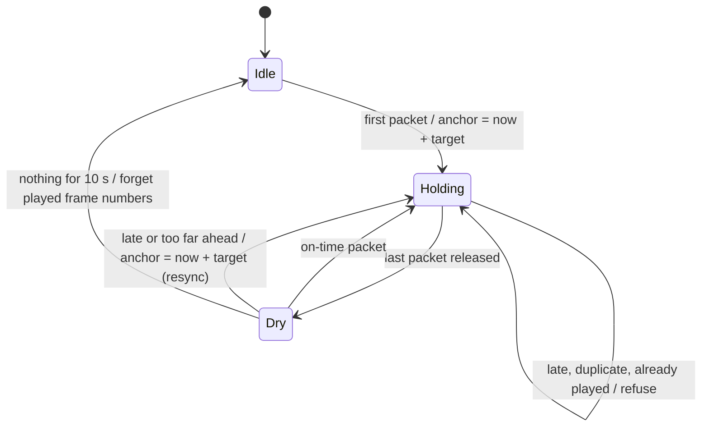

# Voice timing on the radio (T-MSG1, part 1)

The radio holds push-to-talk voice packets and releases them on its own clock, so the delay does not depend on the phone link (Bluetooth or USB, both bursty). Code: [`firmware/modem-core/src/voice/`](../firmware/modem-core/src/voice/mod.rs). Task card: [#46](https://github.com/joinoasa/oasa-radio/issues/46).

**Status:** logic and host tests only. No board exists yet: nothing here has run on a radio, transmitted or been timed on a bench. Wiring into `firmware/rak4631` and the bench timing trace are part 2.

## What it does

One type, `Pacer`, with two settings:

- **Transmit scheduler** (`TxScheduler`, `Config::TX`): the phone hands over packets whenever its link delivers them. The radio holds each one and sends it at an even pace.
- **Receive playout buffer** (`PlayoutBuffer`, `Config::RX`): packets heard on the air, late, lost, duplicated or out of order, are held and handed to the phone at an even pace.

A packet is opaque bytes (oasa-link has encrypted them) plus two numbers: `seq`, the number of its first codec frame (counts frames on the talker's clock, wraps at 2^16), and `frames`, how many codec frames it holds. **These two numbers are a placeholder.** How they travel between phone and radio and on the air waits for the phone-link spec (oasa-sec #40); here they are plain arguments and nothing is encoded.

Time is an argument: microsecond ticks on the radio's clock (`u32`, wraps every 71.6 minutes; compared with wrapping arithmetic). Nothing reads a clock. `no_std`, no allocation, no `unsafe`, no new dependency.

## The schedule

The schedule maps a frame number to a time: frame `anchor_seq` is due at `anchor_at`, each later frame one frame length (40 ms) after. A packet is released at the time of its first frame, so packets go out exactly one packet interval apart, and a lost packet leaves its time as a gap (the phone conceals it).

Rules, in order, for a packet arriving at `now`:

1. Bad (no bytes, over 128 bytes, `frames` 0 or over 16): refused.
2. Its frames were already played or skipped: refused (`Stale`). A late duplicate is never played twice.
3. Overlaps a held packet: refused (`Duplicate`).
4. First packet: the schedule starts, due at `now + target`.
5. Nothing held and the packet is off the schedule (late, or past the longest hold): **resync**, the schedule starts again at `now + target`. This is a new talk spurt, a gap, or drift that used up the delay.
6. Late while later packets are held: refused (`Late`).
7. Past the longest hold: **catch up** by one step: drop the oldest held packet, and the next one takes its time. Allowed only if that brings the new packet inside the hold and removes at most one longest hold of time; otherwise refused (`TooEarly`), so a jump in the frame count never empties the buffer.
8. All slots full: catch up the same way if the packet is the newest, else refused (`Full`).
9. Otherwise held.

On each release the schedule is re-based on the released packet, so frame differences stay small however long the stream runs.

**Clock drift.** The talker's radio sets the pace on air (its transmit scheduler), the listener's radio the pace of playout; the two crystals differ. A talker that is slow uses up the playout delay and causes one resync (a pause of up to the delay); one that is fast fills the buffer up to the longest hold and causes one catch-up (one packet skipped). At 100 ppm apart (two crystals at 50 ppm, *est.*) the first event comes after about 160 ms / 100 ppm = 1,600 s of continuous talk, far longer than a push-to-talk turn; a test runs 60 s at ±100 ppm with no event at all. No finer drift tracking is done.

## Numbers

| Number | Value | Source |
|---|---|---|
| Frame length | 40 ms (Codec 2 700C and 1200; 2400 is 20 ms, a config value) | oasa-lab [`docs/voice-lora-sim.md`](https://github.com/joinoasa/oasa-lab/blob/main/docs/voice-lora-sim.md), from Codec 2 `codec2.c` |
| Frames per packet | 2: a packet every 80 ms, 30 bytes (2 × 4 B + 22 B link overhead) | voice-lora-sim.md: the lowest-delay interval that meets the plan for 700 bit/s on SF7 250 kHz, SF7 500 kHz and SF8 500 kHz, direct and relayed. Each packet states its own count; the logic does not assume 2 |
| Link overhead | 22 bytes per packet | voice-lora-sim.md (oasa-sec link v0 §3) |
| Slot size | 128 bytes | Chosen here: holds every packet in the `l1-voice-lora` sweep (largest 118 B, 2400 bit/s at 320 ms) |
| Most frames per packet | 16 | Chosen here: the largest in the sweep (16 × 20 ms) |
| Slots | 16 per pacer | Chosen here: the longest hold (320 ms) at an 80 ms interval needs 5; 16 leaves room for one-frame packets |
| Transmit lead | 40 ms | Chosen here (one frame). Absorbs phone-link delay of the packets after the first. To be set from the part 2 trace of the real link |
| Transmit longest hold | 120 ms | Chosen here: lead plus one packet interval. A phone link that hands over two packets at once (160 ms apart) stays inside it; a test checks that |
| Playout delay | 160 ms | Chosen here: two packet intervals. The `l1-voice-lora` sweep has no jitter (perfect channel access, no listen-before-talk), so air jitter is **not measured**; the crowd simulation (oasa-lab branch `t-msg1-crowd-sim`, not merged) waits up to 2^7 CAD times in listen-before-talk backoff, about 164 ms at SF7 250 kHz, so a busy channel can exceed it |
| Playout longest hold | 320 ms | Chosen here: twice the delay |
| Forget time | 10 s | Chosen here: far longer than any relay delay |
| Memory | 2,232 bytes per pacer (16 slots of 134 B plus state); 4,464 bytes for both | `memory_is_fixed` test, `size_of` on the host (x86-64). On the nRF52840 (32-bit) it can only be smaller or equal |

oasa-lab run used for the delay numbers: `l1-voice-lora --seed 1`, run id `ec38e188bdde4a919a5ccadacc0a3c4a`, lab commit `6bd5f76`, checker PASS.

## Delay budget

The plan's mark is mouth-to-ear under 1 s, direct and through one relay. The l1 "frame delay" runs from the moment a codec frame is complete to the moment the packet holding it has arrived (both hops when relayed): packet assembly, queueing and airtime. This code adds the transmit lead and the playout delay on top. 700 bit/s, 95th percentile from voice-lora-sim.md:

| Setting (700 bit/s) | Air, p95 | + lead 40 + playout 160 (normal) | + 120 + 320 (longest holds) |
|---|---|---|---|
| SF7 500 kHz, 80 ms, relayed | 76 ms | 276 ms | 516 ms |
| SF7 250 kHz, 80 ms, relayed | 112 ms | 312 ms | 552 ms |
| SF8 500 kHz, 80 ms, relayed | 102 ms | 302 ms | 542 ms |
| SF8 250 kHz, 160 ms, relayed (worst plan case) | 264 ms | 464 ms | 704 ms |

So these buffers use 200 ms of the 1 s normally and at most 440 ms. What is left (536 ms in the worst plan case, normal holds) is for what this does not cover: codec delay, the phone-to-radio and radio-to-phone links, processing, and the phone's own audio output. None of those is measured yet.

## Not decided

- The wire format for `seq` and `frames`, phone to radio and on air (phone-link spec, oasa-sec #40). Whether the radio can read them outside the ciphertext, or the phone sends timing separately, is open.
- That `seq` counts talker time through silences (as RTP does). The logic works either way (a frame count that stops in silence leads to a resync at the next talk spurt), but the format should say which.
- Transmit lead and playout delay: chosen, not measured. Part 2 sets them from a bench trace of the real phone link and real air (listen-before-talk, relay turnaround).
- What the phone does with a gap (`lost_frames`): packet-loss concealment is the codec's job, out of scope.
- Whether playout should adapt its delay during a talk spurt. It does not: one schedule per spurt, resync or one-packet catch-up at the edges.

## Tests

`cargo test -p oasa-modem-core voice` (19 tests): in order, lost, late, duplicated (held and already played), out of order (the first packet too), a burst after a gap, a new talk spurt, drift (±100 ppm for 60 s: no event; ±3000 ppm for 120 s: bounded), overflow, a packet far ahead, tick and frame-number wrap, forget after a talker restart, a bursty phone link on transmit, a phone that falls behind, fixed memory. Two seeded randomized tests (own SplitMix64 generator, no dependency): 300 runs of random loss, duplicates, jitter up to 250 ms (which reorders), delay spikes up to 800 ms, a pause and drift up to ±2000 ppm, checking that no frame plays twice, none out of order, the right bytes come out, releases are evenly spaced on one schedule, every packet is released within the longest hold of its arrival, and no more than 16 are held; and 100 runs of a clean link (jitter under 70 ms, ±100 ppm) that must deliver every packet with no event.
