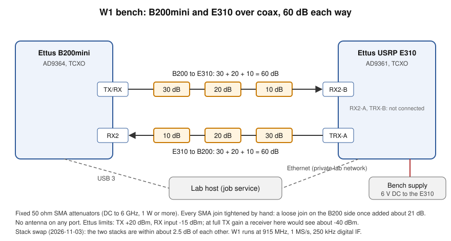

# Waveform W0: a simple modem in simulation

OASA's own waveform, milestone **W0** of the [R-COM2 plan](https://github.com/joinoasa/oasa-lab/blob/main/docs/r-com2-plan.md): "Simple modem in simulation: FSK, then BPSK/QPSK, sync and preamble. Done when: error rate matches theory across signal levels."

Code: the crate [`waveform/`](../waveform) (`oasa-waveform`, pure Rust, no dependencies) and the command `oasa-radio waveform`. Lab suite: `l1-waveform-w0` in oasa-lab. Nothing here touches a radio.

## What it does

| | |
|---|---|
| Modulations | BPSK, QPSK (Gray: first bit of a pair is the I sign, second the Q sign, 0 is positive), 2-FSK (**noncoherent**, continuous phase, tones at +-half the symbol rate, so they are orthogonal over one symbol) |
| Pulse | PSK: root-raised-cosine, roll-off 0.35, 16 symbols long, unit energy, matched filter at the receiver. 2-FSK: constant envelope, rectangular |
| Samples per symbol | 8 by default (4 to 64) |
| Interface | `Modem::modulate(&[u8]) -> Vec<Complex32>` and `Modem::demodulate(&[Complex32]) -> Vec<RxFrame>`. `Complex32` is two `f32`: the same as an SDR's `cf32`. The channel is a separate module and the modem never sees it |
| Frame | preamble (63-chip m-sequence, `x^6+x+1`), sync word (16 bits, default `0x2DD4`), length byte and its complement, payload (0 to 255 bytes), CRC-16/CCITT-FALSE over length and payload. Length, payload and CRC are whitened (PN9). Preamble and sync go out one bit per symbol (BPSK, or tones for FSK) even in QPSK mode |

Overhead: 79 symbols of preamble and sync, plus 32 bits of header and CRC.

## Receiver

1. **Detect.** Correlate the buffer with the known waveform of preamble plus sync at every sample offset. The metric `|c|^2 / (E_ref * E_window)` is 1 for a perfect match. In white noise it is `Beta(1, M-1)` distributed (`M` = 79 x samples per symbol = 632), so a threshold `t` gives a false alarm probability of `(1-t)^(M-1)` per position. Default `t = 0.04`: 6.5e-12. A test checks the formula against 2 million noise positions (within 15 %). At Es/N0 = 0 dB the expected metric is about 0.12, three times the threshold.
2. **Estimate.** From eight-symbol chunks of the preamble: carrier phase, amplitude, and frequency offset (phase slope between chunks). The frequency estimate is used only if it raises the correlation power over zero offset by a clear margin (a likelihood ratio test); otherwise noise-made estimates would put a phase ramp on the whole frame.
3. **Demodulate.** Derotate, then the matched filter at the symbol instants (PSK) or two tone correlators (FSK). For PSK the whole frame body then gets a second look: a Viterbi-and-Viterbi power-law fit of carrier phase and slope over segments of the frame, a decision-directed polish of the phase, and a data-aided choice of the sub-sample matched filter shift (half-sample grid plus parabola). This is what takes the receiver from 4 % above theory to 0 to 2 %.

   Then a joint maximum-likelihood check of that phase line (`ml_line` in `modem.rs`): the known preamble and sync symbols (data taken off) and the body symbols (exact log-likelihood for unknown, equally likely data: `ln cosh` per bit) score each candidate line `a + b k`. Slopes are searched within 5 times the Cramer-Rao bound of the preamble's frequency estimate, `sqrt(6 / (Es/N0 · N (N^2 - 1)))` rad per symbol with N = 79; for each slope the phase within 16 degrees of what the known symbols give. The better-scoring of the power-law line and this one is used. Why: the power law knows the phase only to a quarter turn (QPSK), and at low SNR its slope is noisy. With the coarse search on, the preamble leaves a frequency error near its bound (about 0.0004 cycles per symbol at 0 dB, so 50 to 130 degrees across a 64-byte QPSK frame in the tails), and 4 to 7 % of QPSK frames at 0 dB came out on the wrong quarter turn or turning away (oasa-radio#14): 1.32 x theory, 1.52 x with an offset of 0.018. The known symbols fix the phase near the frame start without ambiguity. Now within 1.03 x from 0 dB, with and without the offset. Cost: about twice the decode time of the receiver without it (`waveform ber`, release build). With no frequency offset and the search off, the wider search occasionally prefers a noise-made slope (4 of 1500 frames at 0 dB): 1.025 x becomes 1.035 x there, nothing measurable from 1 dB.
4. **Check.** Sync word (up to 3 wrong bits of 16), length against its complement, CRC. `RxFrame.crc_ok` says whether the payload can be trusted.

### What is handled

| Impairment | Handled | Evidence |
|---|---|---|
| Unknown start (whole samples) | Yes | tests: random delay up to 400 samples |
| Sub-sample timing | PSK yes; 2-FSK to the nearest sample only | BER with random fractional delay: BPSK +0.9 %, QPSK +7 %, FSK +0.3 % over theory at 6 dB (400 000 bits, seed 3; QPSK z = +2.2) |
| Carrier phase | Yes, any | all BER runs use a random phase per frame |
| Gain | Yes (amplitude is estimated per frame) | test with gain 0.001 to 300 |
| Carrier frequency offset | Default: up to about +-0.8 % of the symbol rate (detection limit). With `cfo_bins` (frequency search in 0.5 % steps): +-4 % tested. With `cfo_search` (coarse FFT search): +-2 symbol rates tested; the limit is just below half the sample rate | tables below. Residual drift over a frame is removed by the segment fit |
| Noise | AWGN only | |
| Several frames in one buffer | Yes, if they do not overlap | test |

CFO table (10 dB Eb/N0, 79 frames of 64 bytes per cell, seed 2; frames found / frames sent). `cfo` is cycles per symbol, so 0.01 is 1 % of the symbol rate:

| cfo | BPSK, QPSK, FSK, default | with `--cfo-bins 8` |
|---|---|---|
| 0.002 to 0.008 | 79/79 | 79/79 |
| 0.012 | 0/79 | 79/79 |
| 0.02 | 1/79 (BPSK), 10/79 (QPSK), 0/79 (FSK) | 79/79 |
| 0.04 | 0/79 | 79/79 |

The single coherent correlation over 79 symbols loses the signal as the offset approaches one turn over the preamble (a null at 1/79 = 1.27 %, then weaker lobes). The bins search around that. The frequency estimate itself works to +-6 % (phase step between 8-symbol chunks), more than the bins cover.

### Coarse frequency search (`cfo_search`)

For radios with plain crystals: two Plutos can be about 50 ppm apart, 46 kHz at 915 MHz, which is 1.8 symbol rates at 25 kbaud. `RxConfig::cfo_search = MAX` (cycles per symbol; `--cfo-search MAX` on the command line) finds frames anywhere in +-MAX. Off by default.

**Method.** Every 2 samples (`sps / 4`), the receiver multiplies the 632-sample window by the conjugate of the known preamble and sync waveform. That removes the chips: if a frame starts there, what is left is a tone at the carrier offset. An FFT of the product (zero padded to 1024 points, about 1.5 times the window) gives the correlation at every trial frequency at once; the strongest bin within +-MAX, refined by a parabola through its neighbours, is the coarse estimate. For a narrow search the product is first summed in chunks (so `0.5` at 8 samples per symbol uses chunks of 3 and a 512-point FFT); the chunk is kept short enough that it loses at most 0.6 dB at the edge of the range. Candidates must be the strongest within one window length (632 samples). Then the receiver turns the buffer back by the coarse frequency and runs the normal single-frequency detector and decoder in a small window around the candidate, which removes the rest (the coarse estimate is within about 0.001 cycles per symbol). The reported `cfo_cycles_per_symbol` and `phase_rad` are for the buffer as received.

**False alarms.** Each FFT bin is the normal metric for a reference shifted to that frequency, so in noise it is `Beta(1, M-1)` like before. Taking the largest of `cells` bins (529 for +-2.05 at 8 samples per symbol) multiplies the chance that a noise position passes by about `cells`. The threshold is raised to cancel that: 0.04 becomes 0.0495, so the false alarm probability per position stays 6.5e-12. Counting every bin examined is slightly conservative: in 400 000 noise samples the measured rate was 1.00 to 1.03 times the bound for the wide search and 0.80 to 0.88 for the chunked one (`coarse_metric_follows_its_noise_bound`). The price is sensitivity, in two parts:

* The threshold is 24 % (0.9 dB) higher.
* The search sees less than the full peak. The FFT's bins (1/1024 cycle per sample) are wider than the zero padding needs for a flat response, and the time grid is 2 samples. Measured on clean frames at 66 offsets across one bin, against the plain metric at zero offset and exact timing: BPSK -0.48 dB on average, -1.40 dB at worst (halfway between bins); 2-FSK -0.68 dB average, -1.69 dB worst. The chunked narrow search: -0.48 and -1.16 dB (BPSK), -0.67 and -1.44 dB (FSK).

So at worst the search needs about 2.5 dB more preamble energy than the plain receiver to cross its threshold. The normal metric still sets the frame's timing and frequency afterwards, so decoding loses nothing (BER table below). At Es/N0 = 0 dB the expected metric is about 0.12; less 1.7 dB that is 0.08, still above the 0.0495 threshold. Padding the FFT to 2048 would cut the worst case to about -0.5 dB at about twice the cost; not done, since nothing needed it.

**Cost.** A 1024-point FFT per 2 samples instead of one 632-point correlation per sample. Detection time for a 5000-sample buffer (noise only, so the whole search runs; release build, 2 CPUs, mean of 40, BPSK and FSK the same within 1 %):

| Receiver | ms per buffer |
|---|---|
| plain (before) | 2.9 |
| `cfo_bins 8` (before; covers +-4 %) | 49.2 |
| `cfo_search 0.5` (chunks of 3, 512-point FFT) | 11.1 |
| `cfo_search 2.05` (1024-point FFT) | 24.5 |

At 25 kbaud and 8 samples per symbol a 5000-sample buffer is 25 ms of air, so the wide search keeps up on one core with almost nothing to spare. A streaming receiver should run it once per new block, not over old samples again.

Detection and estimate across offsets (from `coarse_search_decodes_across_two_symbol_rates`: 3 frames each at 12 offsets from -2.0 to +2.0, including the plain correlation's null at 0.0253; PSK at 12 dB, FSK at 16 dB, random phase, delay and sub-sample delay): every frame decoded, started at the right sample, and gave its offset to within 0.002 cycles per symbol.

BER with the search on (`--cfo-search 2.05`), Eb/N0 = 8 dB, 64-byte frames, random phase, start delay and sub-sample delay; each row 400 384 bits, seed 7. Every frame was found in every row:

```
oasa-radio waveform ber --mod bpsk --ebn0-db 8 --bits 400000 --seed 7 --cfo C --cfo-search 2.05 --random-frac-delay
```

| cfo (cycles/symbol) | BPSK errors | ratio | z | QPSK errors | ratio | z | 2-FSK errors | ratio | z |
|---|---|---|---|---|---|---|---|---|---|
| -2.0 | 79 | 1.034 | +0.3 | 86 | 1.125 | +1.1 | 8 666 | 1.015 | +1.4 |
| -1.3 | 68 | 0.890 | -1.0 | 73 | 0.955 | -0.4 | 8 730 | 1.023 | +2.1 |
| 0 | 82 | 1.073 | +0.6 | 95 | 1.243 | +2.1 | 8 748 | 1.025 | +2.3 |
| 0.5 | 86 | 1.125 | +1.1 | 77 | 1.007 | +0.1 | 8 543 | 1.001 | +0.1 |
| 1.0 | 81 | 1.060 | +0.5 | 76 | 0.994 | 0.0 | 8 534 | 1.000 | 0.0 |
| 1.5 | 77 | 1.007 | +0.1 | 82 | 1.073 | +0.6 | 8 650 | 1.013 | +1.2 |
| 2.0 | 65 | 0.850 | -1.3 | 77 | 1.007 | +0.1 | 8 737 | 1.023 | +2.2 |

Theory: 1.909e-4 (PSK), 2.132e-2 (2-FSK). With only 70 to 95 errors a PSK row's ratio has a sampling spread of about +-11 %; every z is within +-2.3.

Acceptance run (`cargo test --release -p oasa-waveform --test ber coarse_search_long -- --ignored`): 2 000 384 bits per modulation at 8 dB, every frame with its own offset uniform in +-2 symbol rates, random sub-sample delay, seed 1. Measured on 2026-10-30:

| Mod | frames found | errors | BER | theory | ratio | z |
|---|---|---|---|---|---|---|
| BPSK | 3907/3907 | 365 | 1.825e-4 | 1.909e-4 | 0.956 | -0.9 |
| QPSK | 3907/3907 | 417 | 2.085e-4 | 1.909e-4 | 1.092 | +1.8 |
| 2-FSK | 3907/3907 | 42 822 | 2.141e-2 | 2.132e-2 | 1.004 | +0.8 |

QPSK's 9 % is within its sampling error (z = +1.8; one sigma is 5 % at 380 expected errors), and the plain receiver's QPSK rows above sit at +0.4 to +2.1 % on much larger counts.

### Not handled

- Sample clock offset between transmitter and receiver (no symbol clock tracking; frames are short).
- Fading, multipath, interference, IQ imbalance, a DC offset. (The Pluto has a DC spike; see W1 below.)
- A continuous stream: `demodulate` takes one buffer and searches all of it. Cost grows as buffer length x 632 multiplications (about 3 ms for a 5000-sample frame buffer at 8 samples per symbol in a release build). A streaming receiver needs a sliding buffer.
- Coherent 2-FSK. The theory function exists (`ber_bfsk_coherent`) but the receiver is noncoherent.
- No FEC on the payload. W2. The W0 header (length and complement, unprotected) loses a frame to one flipped bit: found-frame rate 27 % at 0 dB and 82 % at 4 dB. [Frame format v1](frame-v1.md) fixes that; W0 stays the default.

## Energy and SNR conventions

This is where simulations go wrong, so it is stated once and tested at the source (the lab suite measures it from the written IQ file with its own Python code).

* The modulator makes the energy of one **symbol**, the sum of `|x|^2` over its samples, equal to 1. So `Es = 1` and `Eb = 1 / bits per symbol`, whatever the samples per symbol. (Mean power per sample is then `1/sps`.)
* The channel adds complex Gaussian noise of variance `N0` per sample (half in I, half in Q), for the whole sampling band. A unit-energy matched filter then sees noise of variance `N0`, independent of oversampling. `N0 = Eb / (Eb/N0)`.
* `Es/N0 = Eb/N0 x bits per symbol`. The SNR per sample (signal power over noise power, both per sample) is `Es/N0 / sps`: at 8 samples per symbol, BPSK, that is 9.03 dB **below** Eb/N0. Using it as Eb/N0 is the classic bug; `test_wrong_ebn0_claim_is_rejected` shows that error is 20 sigma off.
* Preamble, sync and header are not counted in Eb: Eb/N0 refers to the payload bits only. Preamble symbols have the same energy as payload symbols.
* Theory: BPSK and QPSK `Q(sqrt(2 Eb/N0))`; noncoherent orthogonal BFSK `0.5 exp(-Eb/2N0)`; coherent BFSK `Q(sqrt(Eb/N0))` (not used). `Q` is built on a hand-written `erfc` (power series below 2.5, continued fraction above), tested to a relative error under 1e-12 at twelve points against Python's `math.erfc`.

## Measured BER against theory

Command (release build; every line is JSON; 2 000 000 bits a point, 10 000 000 for BPSK and QPSK at 10 dB, 4 000 000 for FSK at 10 dB):

```
oasa-radio waveform ber --mod bpsk --ebn0-db 0,2,4,6,8 --bits 2000000 --seed 1 --json
oasa-radio waveform ber --mod qpsk --ebn0-db 0,2,4,6,8 --bits 2000000 --seed 1 --json
oasa-radio waveform ber --mod fsk2 --ebn0-db 0,2,4,6,8 --bits 2000000 --seed 1 --json
oasa-radio waveform ber --mod bpsk --ebn0-db 10 --bits 10000000 --seed 1 --json   # likewise qpsk; fsk2 with 4000000 bits
```

Frames of 64 random bytes, random start delay (2 to 63 samples), random carrier phase, 8 samples per symbol, seed 1 (mixed with the modulation and Eb/N0). Every frame was found (detected = sent in every row). `z` is the binomial z-score of the error count against theory. Measured on 2026-10-26.

| Mod | Eb/N0 dB | bits | errors | BER measured | BER theory | measured / theory | z |
|---|---|---|---|---|---|---|---|
| BPSK | 0 | 2 000 384 | 158 700 | 7.934e-2 | 7.865e-2 | 1.009 | +3.6 |
| BPSK | 2 | 2 000 384 | 75 647 | 3.782e-2 | 3.751e-2 | 1.008 | +2.3 |
| BPSK | 4 | 2 000 384 | 25 098 | 1.255e-2 | 1.250e-2 | 1.004 | +0.6 |
| BPSK | 6 | 2 000 384 | 4 848 | 2.424e-3 | 2.388e-3 | 1.015 | +1.0 |
| BPSK | 8 | 2 000 384 | 394 | 1.970e-4 | 1.909e-4 | 1.032 | +0.6 |
| BPSK | 10 | 10 000 384 | 38 | 3.80e-6 | 3.87e-6 | 0.981 | -0.1 |
| QPSK | 0 | 2 000 384 | 160 673 | 8.032e-2 | 7.865e-2 | 1.021 | +8.8 |
| QPSK | 2 | 2 000 384 | 76 022 | 3.800e-2 | 3.751e-2 | 1.013 | +3.7 |
| QPSK | 4 | 2 000 384 | 25 061 | 1.253e-2 | 1.250e-2 | 1.002 | +0.4 |
| QPSK | 6 | 2 000 384 | 4 796 | 2.398e-3 | 2.388e-3 | 1.004 | +0.3 |
| QPSK | 8 | 2 000 384 | 387 | 1.935e-4 | 1.909e-4 | 1.013 | +0.3 |
| QPSK | 10 | 10 000 384 | 43 | 4.30e-6 | 3.87e-6 | 1.110 | +0.7 |
| 2-FSK nc | 0 | 2 000 384 | 606 276 | 3.031e-1 | 3.033e-1 | 0.999 | -0.6 |
| 2-FSK nc | 2 | 2 000 384 | 451 589 | 2.258e-1 | 2.264e-1 | 0.997 | -2.1 |
| 2-FSK nc | 4 | 2 000 384 | 285 208 | 1.426e-1 | 1.424e-1 | 1.001 | +0.7 |
| 2-FSK nc | 6 | 2 000 384 | 136 529 | 6.825e-2 | 6.831e-2 | 0.999 | -0.3 |
| 2-FSK nc | 8 | 2 000 384 | 42 726 | 2.136e-2 | 2.132e-2 | 1.002 | +0.3 |
| 2-FSK nc | 10 | 4 000 256 | 13 616 | 3.404e-3 | 3.369e-3 | 1.010 | +1.2 |

Reading it: 2-FSK sits on the curve. BPSK and QPSK are on it at 4 dB and up (within the sampling error) and **slightly above** at low Eb/N0: up to 2 % (QPSK at 0 dB, about 0.02 dB) , which is significant with two million bits (z = 8.8) but small. The cause is the receiver's own timing and phase estimation noise on a 79-symbol preamble; with the true timing handed to the receiver the BER matched theory (ratio 0.998 at 4 dB, 1.5 million bits, in a debug experiment that is not kept in the code). A receiver can only lose to the ideal, never beat it, so the tests allow "up to 5 % above theory" at 0 dB and 3 sigma elsewhere. The two 10 dB rows have only 38 and 43 errors: their ratio is not meaningful beyond "within sampling error".

## Tests

`cargo test --locked --workspace` (debug build; `Cargo.toml` optimizes the `oasa-waveform` crate in the dev profile so the Monte Carlo runs fast):

| Where | Tests | Time (2 CPUs, another build running) |
|---|---|---|
| `waveform` unit tests | 25 (2 new: the FFT against a direct DFT, a tone in its bin): erfc and the BER curves against Python values, Wilson and z-score, RRC (unit energy, near-Nyquist), m-sequence autocorrelation, CRC-16 check value `0x29B1`, whitening, generator and Gaussian statistics, channel noise power and conventions, fractional delay | 0.01 s |
| `waveform/tests/ber.rs` | 10 (+2 ignored, `long_sweep` and `coarse_search_long`): QPSK with the coarse search within 1.1 x theory at 0, 1 and 2 dB with and without an offset (oasa-radio#14); BER with the coarse search and offsets in +-2 symbol rates; BER at five Eb/N0 points per modulation with fixed seeds, independence of oversampling (4 and 16 samples per symbol), a 1 dB wrong claim must fail, BPSK = QPSK per Eb/N0, seeds repeat, 0.4 % frequency offset, random sub-sample delay | about 13 s |
| `waveform/tests/frames.rs` | 25 (7 new for the coarse search: 12 offsets from -2 to +2 per modulation, the true carrier phase, the plain receiver misses what it finds, four frames with their own offsets, noise only gives nothing, its noise bound, its settings): energy convention, round trips with random delay and phase, high-SNR round trip with random offsets, frequency offset estimated and tracked, frequency bins, gain, several frames, **noise-only gives no frames**, the detection metric follows its noise theory, **damaged frames fail the CRC** (also at every position in the body), wrong sync word, no preamble, truncated frame, sub-sample delay, payload limits | about 6 s |
| `tests/cli.rs` | 3: `ber` JSON lines repeat from the seed, `iq` writes a SigMF pair that `decode` reads back (all three modulations), bad arguments | 1 s |

The long sweep (`cargo test --release -p oasa-waveform -- --ignored`) is 2 million bits a point from 0 to 10 dB.

Lab suite `l1-waveform-w0` (needs `OASA_RADIO_BIN_DIR`): BER by modulation and Eb/N0 with theory computed in Python (`math.erfc`) and the limit `ber_z` within +-3, the written IQ's symbol energy and noise power measured from the cf32 file, round trips with phase, delay, sub-sample delay and frequency offset, and four known-bad cases that must be rejected: a claim 1 dB off, no preamble, noise only, a damaged payload.

## W1 on hardware: B200mini and E310 over cable (2026-11-04)

The modem above, unchanged, between two real radios: an Ettus B200mini and an Ettus USRP E310 joined by coax and
fixed attenuators, 60 dB each way, at 915 MHz. Lab suite `l2-waveform-w1` in
[oasa-lab](https://github.com/joinoasa/oasa-lab) (code `oasa_lab/w1test.py`, method in its docs/hardware-suites.md).



How it is run: `oasa-radio waveform iq` writes 24 frames with known random 64-byte payloads; they are joined with 400
samples of silence each, shifted up by a **digital IF of 250 kHz**, scaled to a peak of 0.5 and sent on repeat at **1
MS/s** (125 kbaud, 8 samples per symbol). The other radio records four repeats; the recording is shifted back down
and `oasa-radio waveform decode --cfo-search 0.1` finds the frames. **Eb/N0 is measured from the recording** in this
page's convention: Es from the power on the frames minus the power in the gaps, N0 from the noise spectrum of the
gaps inside the signal band.

Bit error rate against theory, real radios, outside the job service (bundle checked with `--require-hardware`).
Loss = measured Eb/N0 minus the Eb/N0 at which theory gives the measured BER:

| Direction | Mod | Eb/N0 dB | errors / bits | BER | theory | loss dB |
|---|---|---|---|---|---|---|
| E310 to B200 | BPSK | 3.44 | 668 / 30 208 | 2.21e-2 | 1.79e-2 | +0.37 |
| | | 5.25 | 273 / 45 568 | 5.99e-3 | 4.82e-3 | +0.26 |
| | | 7.01 | 35 / 48 640 | 7.20e-4 | 7.60e-4 | -0.04 |
| B200 to E310 | BPSK | 3.45 | 676 / 32 256 | 2.10e-2 | 1.77e-2 | +0.29 |
| | | 5.23 | 255 / 44 544 | 5.72e-3 | 4.91e-3 | +0.18 |
| | | 6.77 | 29 / 48 640 | 5.96e-4 | 1.02e-3 | -0.43 |
| E310 to B200 | QPSK | 3.38 | 982 / 33 280 | 2.95e-2 | 1.84e-2 | +0.87 |
| | | 4.93 | 255 / 44 544 | 5.72e-3 | 6.32e-3 | -0.12 |
| | | 7.13 | 33 / 46 592 | 7.08e-4 | 6.51e-4 | +0.07 |
| B200 to E310 | QPSK | 3.36 | 727 / 36 352 | 2.00e-2 | 1.87e-2 | +0.12 |
| | | 5.00 | 249 / 44 544 | 5.59e-3 | 5.95e-3 | -0.08 |
| | | 7.04 | 34 / 47 104 | 7.22e-4 | 7.35e-4 | -0.01 |

Every point is within 0.9 dB of theory, so within W1's 1 dB of the simulation (which sits on theory, above).
Known-bad checks on the same bench: a recording with no transmitter gives no frames; a BPSK recording decoded as
QPSK passes no CRC (as BPSK, 64 frames pass).

What the bench taught, in the order it was found:

1. **200 kS/s does not work on this pair.** The frames were in the recording (in-band 14 dB over the noise; a
   cross-correlation with the sent file found them at the expected clock offset), yet nothing decoded, while the same
   file decoded 24 of 24 with no radio in between. The E310 has no DSP (UHD: "No DSP capabilities detected"), so low
   rates go straight to the AD9361; the likely cause, not proven. 1 MS/s works.
2. **Zero IF costs about 5 dB.** At 1 MS/s with the signal at DC, BPSK was about 5 dB off theory and frames were
   missed: the receivers' DC offset and LO leak sit on the signal (item 3 of the list below). A digital IF of 250 kHz
   puts the DC spike outside the 170 kHz signal band and removes the loss.
3. **The two crystals differ by about 2.5 ppm** (2.25 kHz at 915 MHz, 0.018 cycles per symbol at 125 kbaud),
   mirrored between directions. `--cfo-search 0.1` covers it with room.
4. **Measuring Eb/N0 needs care.** N0 must be taken inside the signal band: out of band, the radios' filters shape
   the noise and the BER looked 2 to 3 dB better than theory, which a real receiver cannot be. An averaged
   spectrum must not get the single-periodogram median correction (it adds 1.6 dB).
5. **A loose SMA join once added about 21 dB** on one path. Tighten every join and re-measure.

Not covered yet: 2-FSK; points below about 3 dB (frames are missed there, so the BER is for the frames found); more
bits at 7 dB (about 30 errors a point); other radio pairs (Plutos). A streaming receiver (item 1 below) is still
needed for continuous operation.

## What W1 needs (two Plutos over cable)

Not done; listed so W1 starts from facts.

1. **IQ in and out.** `modulate` and `demodulate` already speak `Complex32`. A thin `sdr` adapter must scale to the DAC (12-bit; amplitude well below full scale to stay linear), pick a sample rate that is `symbol_rate x sps`, and hand the receiver blocks of at least one frame plus margin. A streaming receiver (sliding buffer, no re-search of old samples) is needed for continuous operation.
2. **Frequency offset.** Two independent crystals. The lab's own limits ([hardware-suites](https://github.com/joinoasa/oasa-lab/blob/main/docs/hardware-suites.md)) assume a Pluto+ TCXO of 0.5 ppm, so two of them differ by up to 1 ppm: 915 Hz at 915 MHz, 2.4 kHz at 2.4 GHz. A plain Pluto crystal is 20 to 25 ppm (the same page's wording for a plain crystal); two such differ by up to about 50 ppm, 46 kHz at 915 MHz. Against the 25 kHz symbol rate used in the examples that is 4 % for the TCXO at 915 MHz and over 100 % for the plain crystal. The coarse frequency search (`--cfo-search`, above) covers both: set MAX a little above the worst offset in symbol rates (2.05 for plain crystals at 25 kbaud). For a TCXO a small MAX keeps the cost down. **Unverified:** the Pluto sample rate limits (I recall about 65 kS/s to 61.44 MS/s with the AD9363) and its 12-bit converters; check the ADI documentation before choosing rates. No network was available for this task.
3. **DC offset and LO leakage** at zero IF: shift the signal off DC (a small digital frequency shift, the receiver already removes a frequency offset) or remove DC before detection.
4. **Transmit on cable only**, with the 60 dB rule of the lab, and gain set so the receiver does not clip. The amplitude is estimated per frame, but a clipped signal is not recoverable.
5. **Sample rate and gain settings recorded** in the SigMF file. `oasa-radio waveform iq` already writes `core:datatype`, `core:sample_rate`, `core:frequency` and `core:datetime`; it does not write `core:sha512` (the lab's own writer adds it when a recording is registered with a device).
6. **Measure on the bench** what the simulation cannot say: real noise figure and bandwidth, so Eb/N0 at the receiver is known from a power measurement, then repeat this BER table over cable with an attenuator.
7. Then **W2**: FEC and OFDM. The payload has no FEC yet; whitening and CRC are in place. The header is the exception: [frame format v1](frame-v1.md) protects it with a convolutional code (`fec.rs`, reusable for the payload), because the W0 header loses frames below about 4 dB.

## Notes on sources and what is unverified

* All algorithms are textbook and written here: RRC pulse, m-sequence, PN9 whitening, CRC-16/CCITT-FALSE (check value verified), xoshiro256** (public domain, Blackman and Vigna) seeded by splitmix64, Box-Muller, Viterbi-and-Viterbi phase estimation. No outside radio project was used, so nothing goes in the software register.
* The 5 % allowance in the tests, the likelihood-ratio threshold (15), the statements about implementation loss and the frequency ranges are measured or chosen here, from the runs above; they are not from a reference.
* The Pluto figures in the W1 section are from the lab's docs (ppm) or from memory (rates, converters; unverified).
* One estimate was dropped on purpose: a decision-directed phase-locked loop was tried first and removed, because with a noisy frequency estimate it left 10 % excess errors at low Eb/N0.
